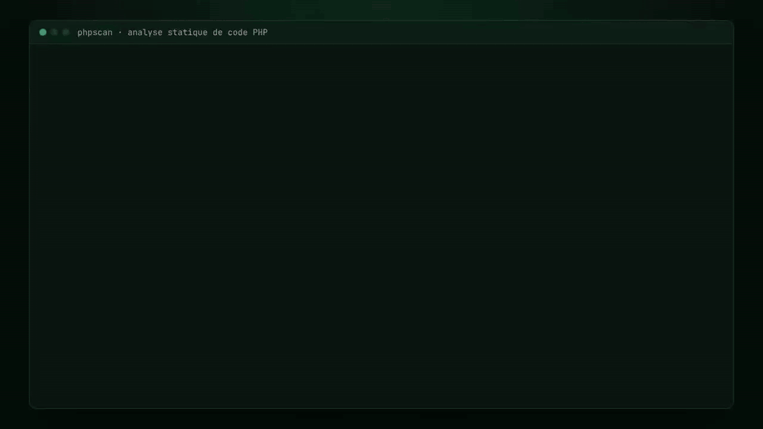

# phpscan

[](https://github.com/RIZIWYX/PHPScan/actions/workflows/ci.yml)


[](LICENSE)



> **Outil pédagogique.** phpscan n'a pas vocation à remplacer Semgrep, Bandit ou un audit de sécurité professionnel. Il sert à comprendre comment fonctionne une analyse statique de sécurité, et à mesurer honnêtement ses limites.

Analyseur statique qui scanne du code PHP et signale des motifs à risque : injections SQL par concaténation, exécution de code ou de commandes, secrets en dur, hachage faible de mots de passe, entrées utilisateur non filtrées.

Trois moteurs de détection, au choix avec `--engine` :
- **regex** : recherche de motifs dans le texte
- **ast** : arbre syntaxique PHP via tree-sitter + suivi des données souillées (taint)
- **llm** : analyse par un modèle de langage via une API distante (Groq ou Anthropic)

## Aperçu

Sortie réelle du moteur regex sur deux fichiers du jeu de test :

```text
$ phpscan tests/fixtures/vuln/sqli_concat.php tests/fixtures/vuln/weak_hash.php
──────────────────────── tests/fixtures/vuln/sqli_concat.php ────────────────────────
HIGH   tests/fixtures/vuln/sqli_concat.php:3  PHP-SQLI-001 Requête SQL construite par concaténation de variables
       $res = mysqli_query($db, "SELECT * FROM users WHERE id = " . $id);
       -> Utiliser une requête préparée (PDO::prepare + execute)
───────────────────────── tests/fixtures/vuln/weak_hash.php ─────────────────────────
HIGH   tests/fixtures/vuln/weak_hash.php:2  PHP-HASH-001 md5/sha1 utilisé pour hacher un mot de passe
       $hash = md5($password);
       -> Utiliser password_hash() et password_verify()
─────────────────────────────────────────────────────────────────────────────────────
2 fichier(s) analysé(s), 2 alerte(s) : 2 HIGH
```

## Installation

```bash
git clone https://github.com/RIZIWYX/PHPScan.git
cd phpscan
python -m venv .venv
source .venv/bin/activate        # Windows : .venv\Scripts\activate
pip install -e ".[dev,ast,llm]"   # ast = tree-sitter, llm = client Anthropic
```

## Utilisation

```bash
phpscan chemin/vers/projet
phpscan chemin/vers/projet --format json -o rapport.json
phpscan chemin/vers/projet --format sarif -o rapport.sarif
phpscan chemin/vers/projet --min-severity MEDIUM   # seulement les alertes MEDIUM et plus
phpscan chemin/vers/projet --engine ast            # moteur AST + suivi de souillure (recommandé)
phpscan chemin/vers/projet --engine llm            # moteur LLM (clé API nécessaire)
```

Le moteur LLM lit sa configuration dans l'environnement ou dans un fichier `.env` (ignoré
par Git) à la racine du projet :

```
PHPSCAN_LLM_PROVIDER=groq        # groq (offre gratuite) ou anthropic
GROQ_API_KEY=gsk_...             # ou ANTHROPIC_API_KEY=sk-ant-...
```

Code de sortie : `0` si aucune alerte au-dessus du seuil, `1` sinon (utilisable en CI).

## Règles

| ID | Règle | Sévérité | CWE |
| --- | --- | --- | --- |
| PHP-SQLI-001 | SQL construit par concaténation | HIGH | CWE-89 |
| PHP-EXEC-001 | eval / exec / system / shell_exec | HIGH | CWE-95, CWE-78 |
| PHP-SECRET-001 | Secret en dur | MEDIUM | CWE-798 |
| PHP-HASH-001 | md5 / sha1 pour un mot de passe | HIGH | CWE-916 |
| PHP-INPUT-001 | `$_GET` / `$_POST` utilisé sans filtrage | MEDIUM | CWE-20 |

Le détail de chaque règle (pourquoi c'est risqué, exemple vulnérable, correction) est dans [docs/RULES.md](docs/RULES.md).

## Structure

```
phpscan/
├── src/phpscan/        # CLI, chargement, moteurs regex / ast / llm, rapports
├── rules/default.yml   # Règles en YAML
├── tests/fixtures/     # Fichiers PHP de test (vulnérables et sains)
├── tests/holdout/      # Fichiers de validation, écrits après le moteur AST
├── tests/injection/    # Fichiers avec commentaires de manipulation (injection de prompt)
├── docs/               # Règles et démo sur Yappli
├── benchmarks/         # Comparaison avec Semgrep (à venir)
└── prompts/            # Prompts versionnés du moteur LLM
```

## Tests

```bash
pytest          # 148 tests + 24 limites connues (xfail strict)
ruff check .
```

Chaque faille attendue dans un fichier de test est marquée sur sa ligne par
`// EXPECT: <règle>`. Les cas qu'un moteur rate ou signale à tort sont marqués
`xfail(strict=True)` : ils documentent ses limites. Le moteur LLM est testé sans réseau,
avec un faux client.

## Les trois moteurs

**regex** cherche des motifs dans le texte. Rapide, mais il ne voit pas la structure du
code : il se fait piéger par les chaînes et les commentaires, ne reconnaît pas les
fonctions d'échappement et ne suit pas une valeur d'une ligne à l'autre.

**ast** transforme le code en arbre syntaxique avec [tree-sitter](https://tree-sitter.github.io/)
et suit les données souillées (*taint tracking*) :

```php
$q = $_GET['q'];                 // source : $q devient souillée
$propre = htmlspecialchars($q);  // sanitizer : $propre est sûre
echo $propre;                    // pas d'alerte
echo "Résultats pour $q";        // $q souillée atteint un sink -> PHP-INPUT-001
```

**llm** envoie chaque fichier à un modèle via une API distante (Groq, au format OpenAI, ou
Anthropic). Réponse en JSON imposé par un schéma, cache disque, nouvelles tentatives sur les
erreurs temporaires (429, 5xx), alertes inventées rejetées, coût affiché.

### Comparaison rapide

| | regex | ast | llm |
| --- | --- | --- | --- |
| Comprend la structure du code | non | oui | oui, et le sens |
| Suit une valeur d'une ligne à l'autre | non | oui, dans une fonction | oui |
| Piégé par du code dans un commentaire | non (commentaires retirés) | non | parfois |
| Même résultat à chaque lancement | oui | oui | non |
| Vitesse | instantané | instantané | quelques secondes par fichier |
| Résiste à l'injection de prompt | oui | oui | oui sur nos 5 cas, sans garantie |
| Coût | gratuit | gratuit | API (offre gratuite chez Groq) |

En pratique : l'**ast** est le moteur de référence, fiable, rapide et reproductible. Il est
fait pour la CI. Le **llm** trouve des failles qui demandent de comprendre le code (donnée
passée à une fonction, copie de tableau), mais il est lent et instable : il sert de second
avis. La **regex** reste utile comme point de comparaison et pour analyser le contenu des
chaînes.

## Démo sur un vrai projet : Yappli

phpscan a été lancé sur [Yappli](https://github.com/RIZIWYX/Yappli), un réseau social PHP
sans sécurité déjà audité à la main (12 failles recensées).

| Moteur | Alertes | Vraies failles | Faux positifs |
| --- | --- | --- | --- |
| regex | 0 | 0 | 0 |
| ast | 7 | 7 | 0 |

Le moteur AST trouve **7 XSS réfléchies que l'audit manuel ne citait pas**. La regex
n'en trouve aucune, car le code passe toujours par une variable avant d'afficher. La démo a
aussi révélé un bug du moteur (ternaire), corrigé avec ses tests. En revanche, aucune des
12 failles de l'audit n'est détectée : ce sont des défauts de conception (upload, sessions,
CSRF...) hors de portée de 5 règles à motifs.

Détails, exemples et pistes : [docs/DEMO_YAPPLI.md](docs/DEMO_YAPPLI.md).

## Limites

- Moteur AST intraprocédural : pas de suivi entre fonctions ni entre fichiers, ni dans les propriétés d'objets et cases de tableaux.
- Les regex ne comprennent pas la structure du code (faux positifs dans les chaînes, appels sur plusieurs lignes).
- Pas de prise en charge des frameworks (Laravel, Symfony) ni de leurs fonctions d'échappement.
- Le moteur LLM est non déterministe, lent, et peut en théorie être manipulé par le contenu qu'il analyse.

## Ignorer une alerte

Ajouter `// phpscan-ignore` en fin de ligne.

## Roadmap

- [x] Phase 0 - Préparation du dépôt
- [x] Phase 1 - Chargement des fichiers
- [x] Phase 2 - Règles en YAML
- [x] Phase 3 - Moteur regex + 5 règles
- [x] Phase 4 - Rapports console, JSON, SARIF
- [x] Phase 5 - Jeu de test
- [x] Phase 6 - Moteur AST (tree-sitter + taint)
- [x] Phase 7 - Démo sur Yappli vulnérable
- [x] Phase 7 bis - Moteur LLM (API Groq / Anthropic)
- [ ] Phase 8 - Comparaison avec Semgrep

## Licence

Distribué sous licence **MIT**, voir [LICENSE](LICENSE).
