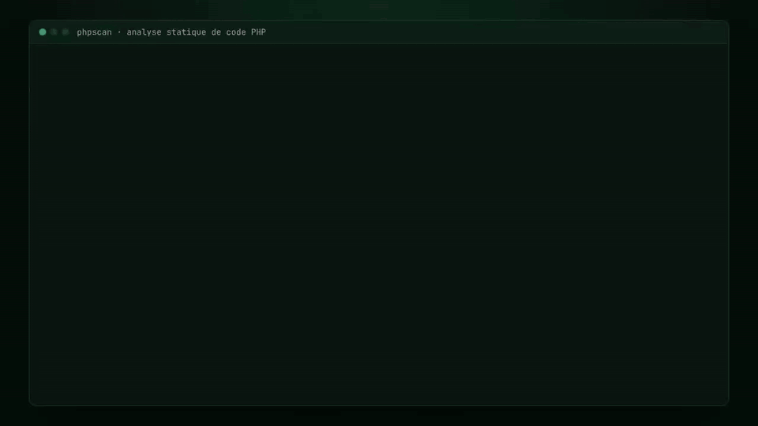

# phpscan

[](https://github.com/RIZIWYX/phpscan/actions/workflows/ci.yml)


[](LICENSE)



> **Outil pédagogique.** phpscan n'a pas vocation à remplacer Semgrep, Bandit ou un audit de sécurité professionnel. Il sert à comprendre comment fonctionne une analyse statique de sécurité, et à mesurer honnêtement ses limites.

Analyseur statique qui scanne du code PHP et signale des motifs à risque : injections SQL par concaténation, exécution de code ou de commandes, secrets en dur, hachage faible de mots de passe, entrées utilisateur non filtrées.

Trois moteurs à comparer sur le même code :
- **regex** *(fonctionnel)* : rapide, simple, nombreux faux positifs
- **ast** *(en cours)* : arbre syntaxique PHP via tree-sitter + suivi de données souillées (taint)
- **llm** *(prévu)* : analyse par un modèle de langage, pour comparaison (le prompt est versionné dans `prompts/`)

## Aperçu

Sortie réelle du moteur regex sur deux fichiers du jeu de test :

```text
$ phpscan tests/fixtures/vuln/sqli_concat.php tests/fixtures/vuln/weak_hash.php
──────────────────────── tests/fixtures/vuln/sqli_concat.php ────────────────────────
HIGH   tests/fixtures/vuln/sqli_concat.php:3  PHP-SQLI-001 Requête SQL construite par concaténation de variables
       $res = mysqli_query($db, "SELECT * FROM users WHERE id = " . $id);
       -> Utiliser une requête préparée (PDO::prepare + execute)
───────────────────────── tests/fixtures/vuln/weak_hash.php ─────────────────────────
HIGH   tests/fixtures/vuln/weak_hash.php:2  PHP-HASH-001 md5/sha1 utilisé pour hacher un mot de passe
       $hash = md5($password);
       -> Utiliser password_hash() et password_verify()
─────────────────────────────────────────────────────────────────────────────────────
2 fichier(s) analysé(s), 2 alerte(s) : 2 HIGH
```

Sur le jeu de test actuel (5 fichiers vulnérables, 3 fichiers sains), le moteur regex détecte les **5 vulnérabilités** et produit **1 faux positif** sur un fichier sain : c'est précisément ce que le moteur AST doit corriger.

## Installation

```bash
git clone https://github.com/RIZIWYX/phpscan.git
cd phpscan
python -m venv .venv
source .venv/bin/activate        # Windows : .venv\Scripts\activate
pip install -e ".[dev]"
```

## Utilisation

```bash
phpscan chemin/vers/projet
phpscan chemin/vers/projet --format json -o rapport.json
phpscan chemin/vers/projet --format sarif -o rapport.sarif
phpscan chemin/vers/projet --engine ast --min-severity MEDIUM
```

Code de sortie : `0` si aucune alerte au-dessus du seuil, `1` sinon (utilisable en CI).

## Règles

| ID | Règle | Sévérité | CWE |
| --- | --- | --- | --- |
| PHP-SQLI-001 | SQL construit par concaténation | HIGH | CWE-89 |
| PHP-EXEC-001 | eval / exec / system / shell_exec | HIGH | CWE-95, CWE-78 |
| PHP-SECRET-001 | Secret en dur | MEDIUM | CWE-798 |
| PHP-HASH-001 | md5 / sha1 pour un mot de passe | HIGH | CWE-916 |
| PHP-INPUT-001 | `$_GET` / `$_POST` utilisé sans filtrage | MEDIUM | CWE-20 |

Le détail de chaque règle (pourquoi c'est risqué, exemple vulnérable, correction) est dans [docs/RULES.md](docs/RULES.md).

## Structure

```
phpscan/
├── src/phpscan/        # CLI, chargement, moteurs regex / ast / llm, rapports
├── rules/default.yml   # Règles en YAML
├── tests/              # Tests pytest + fixtures vulnérables et saines
├── docs/RULES.md       # Explication de chaque règle
├── benchmarks/         # Comparaison avec Semgrep (à venir)
└── prompts/            # Prompt du moteur LLM
```

## Tests

```bash
pytest          # 9 tests + 1 cas attendu en échec (faux positif connu du moteur regex)
ruff check .
```

## Limites

- Analyse intraprocédurale uniquement : pas de suivi entre fonctions ni entre fichiers.
- Les regex ne comprennent pas la structure du code (faux positifs dans les chaînes, appels sur plusieurs lignes).
- Pas de prise en charge des frameworks (Laravel, Symfony) ni de leurs fonctions d'échappement.
- Le moteur LLM est non déterministe, coûteux et sensible à l'injection de prompt.

## Ignorer une alerte

Ajouter `// phpscan-ignore` en fin de ligne.

## Roadmap

- [x] Phase 0 - Préparation du dépôt
- [x] Phase 1 - Chargement des fichiers
- [x] Phase 2 - Règles en YAML
- [x] Phase 3 - Moteur regex + 5 règles
- [x] Phase 4 - Rapports console, JSON, SARIF
- [ ] Phase 5 - Jeu de test et métriques
- [ ] Phase 6 - Moteur AST (tree-sitter + taint)
- [ ] Phase 7 - Démo sur Yappli vulnérable
- [ ] Phase 7 bis - Comparaison avec un LLM
- [ ] Phase 8 - Comparaison Semgrep (précision, rappel, temps par fichier)

## Licence

Distribué sous licence **MIT**, voir [LICENSE](LICENSE).
